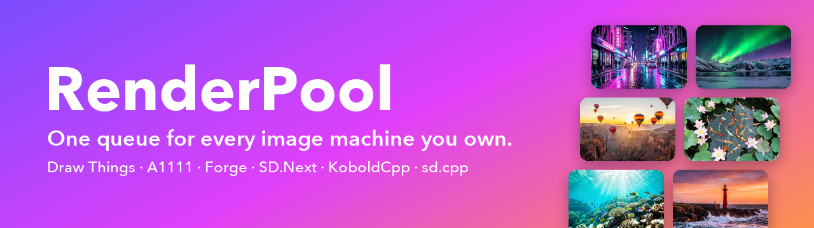
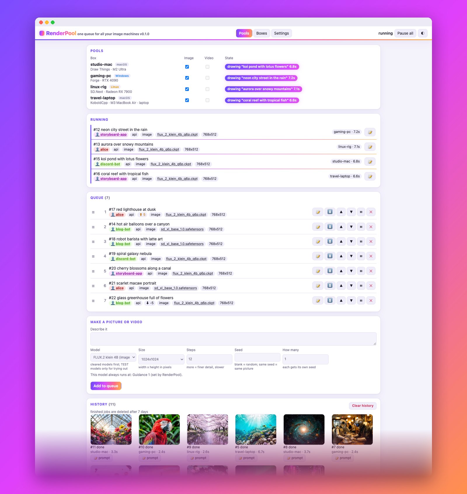
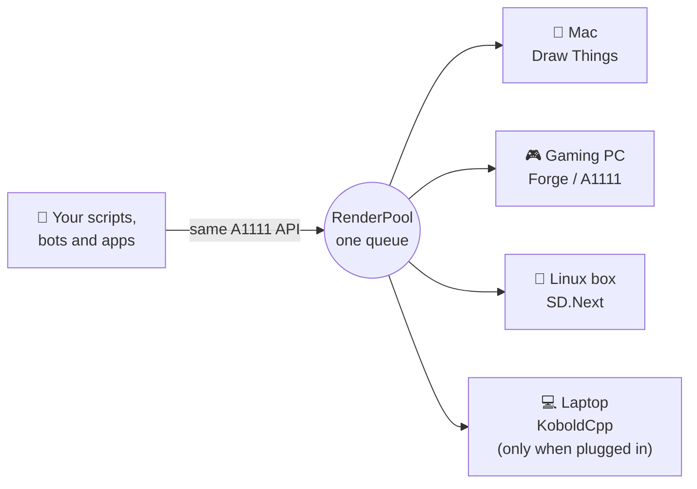
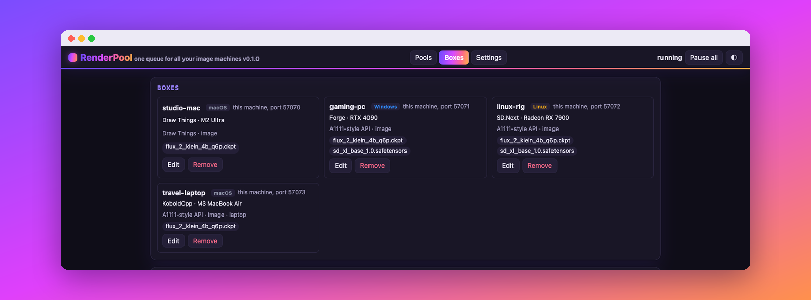

<p align="center">
  
</p>

<p align="center">
  <b>Turn every computer you own into one AI image farm.</b><br>
  Your Mac with Draw Things, your gaming PC with Forge or AUTOMATIC1111, the Linux box with SD.Next,
  the laptop with KoboldCpp: one address, one queue, every machine working.
</p>

<p align="center">
  
  
  
  
  
</p>

<p align="center">
  
</p>

## Why RenderPool?

You have more than one machine that can make pictures. Today you pick one by hand, and the rest sit
idle. RenderPool makes them a team:

- 🚀 **Faster batches.** Four machines draw four pictures at once. A 40-picture storyboard that took an
  hour on one Mac finishes in a fraction of the time.
- 🔌 **Nothing to rewrite.** RenderPool speaks the same API as AUTOMATIC1111. Point any script, bot or
  app at RenderPool instead of one machine. That is the whole change.
- 🧠 **It picks the right machine.** Each job goes to a machine that is free, online, holds the model you
  asked for and, for a laptop, is plugged in. When two are free, the faster one wins.
- 🛟 **Jobs don't get lost.** A machine crashes, freezes or drops off Wi-Fi mid-picture? The job quietly
  moves to another one, and your script still gets its picture on the same request.
- 🖥️ **Mix anything.** Apple Silicon, NVIDIA, AMD, Intel Arc or plain CPU. macOS, Windows or Linux. Draw
  Things next to Forge next to SD.Next, all in one pool.
- 🪶 **Tiny and private.** One Python file plus a web page, standard library only, nothing to install
  but Python. Runs on your own network and sends nothing anywhere else.

## How it works



Your code sends `POST /sdapi/v1/txt2img` to RenderPool, exactly as it would to AUTOMATIC1111. RenderPool
queues the job, hands it to the best free machine and returns that machine's answer on the same
connection, byte for byte.

## Features

| | |
|---|---|
| 🖼️ **Live web page** | See every machine, what it is drawing, the queue and a thumbnail history. Light and dark themes. |
| 🧲 **Drag-and-drop queue** | Reorder, pause, resume or cancel jobs. Move everything from one sender or for one model to the top in one click. |
| 🏷️ **Who sent what** | Every job shows its sender, in its own color. Optional priorities per job. |
| ➕ **Add machines from the page** | Local or over ssh. RenderPool reads each machine's model list itself. |
| 🔋 **Laptop aware** | A laptop on battery drops out of the pool and rejoins when plugged back in. |
| 🩺 **Self-healing** | Reopens Draw Things if it closes, steps around a machine that hangs, and retries a lost job elsewhere. |
| ✅ **Approved models only** | Your scripts can run only the models you have cleared. Anything else is for testing from the page. |
| 🎬 **Image and video pools** | Keep video machines separate, or let a machine do both. |
| 🔐 **Optional password** | One shared password for the page and the API when you open it to your network. |
| 🧩 **Engine plug-ins** | One small class adds a new kind of engine. |

<p align="center">
  
</p>

## Works with

Any app that serves the AUTOMATIC1111-style API (`/sdapi/v1/txt2img` and `/sdapi/v1/img2img`) can join
a pool, and you can mix them freely.

| App | Turn its API on | Runs on | Status |
|---|---|---|---|
| [Draw Things](https://drawthings.ai) | Settings → API Server (HTTP), or gRPC through `dt-grpc-bridge/` | macOS (Apple Silicon) | ✅ **tested daily**, both modes |
| [AUTOMATIC1111 Stable Diffusion WebUI](https://github.com/AUTOMATIC1111/stable-diffusion-webui) | start with `--api` ([API docs](https://github.com/AUTOMATIC1111/stable-diffusion-webui/wiki/API)) | Windows, Linux, macOS · NVIDIA, AMD, Intel, Apple Silicon | 📘 the API RenderPool is built on |
| [Stable Diffusion WebUI Forge](https://github.com/lllyasviel/stable-diffusion-webui-forge) | start with `--api` (same endpoints as A1111) | Windows, Linux · NVIDIA | 📘 documented by Forge |
| [SD.Next](https://github.com/vladmandic/sdnext) | on by default ([API docs](https://github.com/vladmandic/sdnext/wiki/API)) | Windows, Linux, macOS · NVIDIA, AMD (ROCm, ZLUDA), Intel Arc, OpenVINO, Apple Silicon, CPU | 📘 documented by SD.Next |
| [stable-diffusion.cpp](https://github.com/leejet/stable-diffusion.cpp) `sd-server` | its A1111 endpoints ([API docs](https://github.com/leejet/stable-diffusion.cpp/blob/master/examples/server/api.md)) | anywhere it builds · CPU, CUDA, Vulkan, Metal | 📘 documented, including the model list |
| [KoboldCpp](https://github.com/LostRuins/koboldcpp) | load an image model; it serves A1111/Forge-style endpoints | Windows, Linux, macOS · NVIDIA, AMD/Intel (Vulkan), Apple Silicon, CPU | 📘 advertised by KoboldCpp |
| [Stability Matrix](https://github.com/LykosAI/StabilityMatrix) | a launcher: install A1111, Forge or SD.Next with it, then as above | Windows, Linux, macOS | 📘 whatever it installs |

✅ = in daily use with RenderPool. 📘 = the app's own documentation lists every endpoint RenderPool uses;
we have not run it in a pool ourselves yet. Tried one? Please
[open an issue](https://github.com/GH-tjf/renderpool/issues) and tell us how it went.

**Coming later:** [ComfyUI](https://github.com/comfyanonymous/ComfyUI),
[InvokeAI](https://github.com/invoke-ai/InvokeAI) and
[SwarmUI](https://github.com/mcmonkeyprojects/SwarmUI) use their own APIs and need an engine plug-in.
Each is one small class ([how](docs/GUIDE.md#engine-plug-ins)), and contributions are very welcome.

## Quick start (2 minutes)

You need Python 3.9 or newer on the machine that will run RenderPool (macOS or Linux), and at least one
machine with an app from the table above, its API turned on.

```sh
git clone https://github.com/GH-tjf/renderpool.git && cd renderpool
cp config.example.json config.json
python3 renderpool.py serve --config config.json
```

Open **http://127.0.0.1:7875/renderpool/**, click **Boxes**, and add your machines. Then send your
first picture:

```sh
curl -s http://127.0.0.1:7875/sdapi/v1/txt2img -H 'Content-Type: application/json' \
  -H 'X-RenderPool-Seat: alice' \
  -d '{"prompt": "a red lighthouse at dusk", "model": "flux_2_klein_4b_q6p.ckpt", "width": 768, "height": 512}'
```

Already have a script that talks to AUTOMATIC1111 on port 7860? Change its address to port 7875. Done.

<details>
<summary><b>Example config: a Mac with Draw Things and a Linux PC with A1111</b></summary>

```json
{
  "listen": ["127.0.0.1"],
  "port": 7875,
  "cleared_models": [
    {"file": "flux_2_klein_4b_q6p.ckpt", "kind": "image", "label": "FLUX.2 klein 4B",
     "license": "Apache-2.0 (black-forest-labs/FLUX.2-klein-4B LICENSE)",
     "equivalents": ["flux-2-klein-4b.safetensors"], "fixed": {"guidance_scale": 1.0}}
  ],
  "default_model": "flux_2_klein_4b_q6p.ckpt",
  "backends": [
    {"name": "studio", "where": "local", "local_port": 7860, "engine": "a1111", "app": "drawthings",
     "os": "macos", "abilities": ["image"], "laptop": false, "speed_rank": 25,
     "pools": {"image": true, "video": false}},
    {"name": "pc", "where": "ssh", "ssh_host": "me@pc.local", "ssh_key": "id_ed25519",
     "remote_port": 7860, "local_port": 7861, "engine": "a1111", "app": "other", "os": "linux",
     "abilities": ["image"], "laptop": false, "speed_rank": 15, "pools": {"image": true, "video": false},
     "model_map": {"flux_2_klein_4b_q6p.ckpt": "flux-2-klein-4b.safetensors"}}
  ]
}
```

`backends` only seeds the database on the first start. After that, the **Boxes** page is where machines
are added and changed. `model_map` tells RenderPool that the PC's file is the same model under another
name.
</details>

Prefer a command? `pip install .` inside the clone, then `renderpool serve --config config.json`.
To run it at login, see [Running it as a service](docs/GUIDE.md#running-it-as-a-service) (launchd and
systemd examples included).

## Questions

**Does it work with Forge / SD.Next / KoboldCpp / stable-diffusion.cpp?** Yes, if the app's A1111-style
API is on. See [Works with](#works-with).

**Does every machine need the same model?** No. A job only goes to machines that hold its model. Different
file names for the same model are linked with `model_map`.

**Is it a cloud service?** No. It runs on your own computer and talks only to the machines you add.

**Can several people or apps share it?** Yes. That is what it is for. Each job shows who sent it, and the
queue is fair by arrival order unless you set priorities.

**Do I need Draw Things?** No. Any app in the table works, on any mix of hardware.

## Documentation

The [guide](docs/GUIDE.md) covers everything else: how a job is routed, laptops and network drops,
adding machines, cleared and test models, video, headers, the password, every config key, the command
line and the tests.

## Contributing

Bug reports, "it works with X" reports and engine plug-ins are all welcome. Run the tests with
`python3 -m unittest discover -s . -p 'test_*.py'` before sending a pull request. Security issues: see
[SECURITY.md](SECURITY.md).

## License

MIT, see [LICENSE](LICENSE). The sample pictures in the screenshots were made by RenderPool itself, with
FLUX.2 klein 4B (Apache-2.0). `dt-grpc-bridge/` downloads Draw Things' GPL-3.0 protocol files at setup
time; they are not part of this repository (see `dt-grpc-bridge/THIRD_PARTY.md`).
